# صور مراجعة محرك مصحف المدينة

**نموذج بحثي غير معتمد لاستبدال المحرك الحالي.** الهدف المحدد: حفص، مصحف المدينة
KFGQPC V4، طبعة 1441هـ. هذه صور تشغيل عند390×844، وليست صور مصحف ورقي معتمد.

المصدر الجديد لا يعرض زخارف وإطار الافتتاحية الورقية كاملين؛ لا يُعتبر نجاح المقارنة
مع SVG شهادة مطابقة للطبعة. كذلك تظليل كلمتي15:7 منفصلتين ما زال عائق قبول.

| الصفحة | الحالي | نموذج QVP |
|---|---|---|
|1|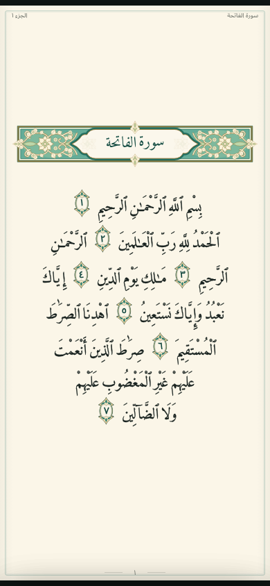|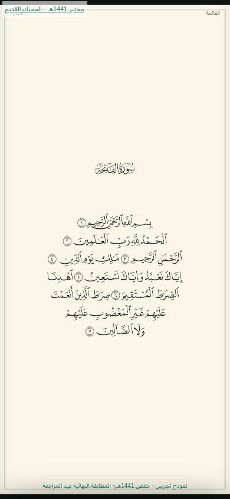|
|4||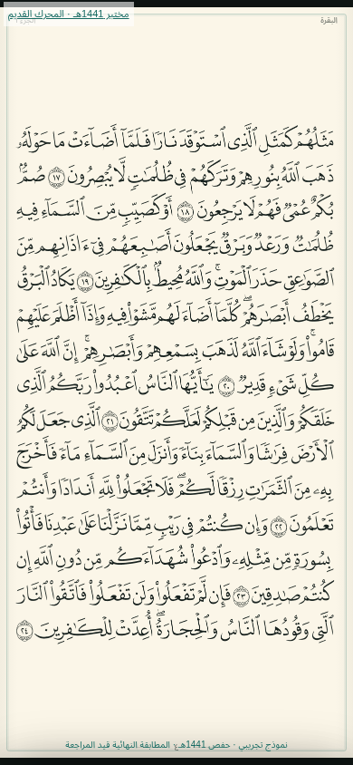|

عينات أخرى:

|48 — آية طويلة|77 — ترويسة|187 — التوبة|
|---|---|---|
|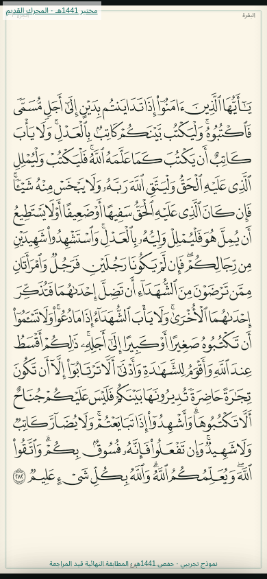|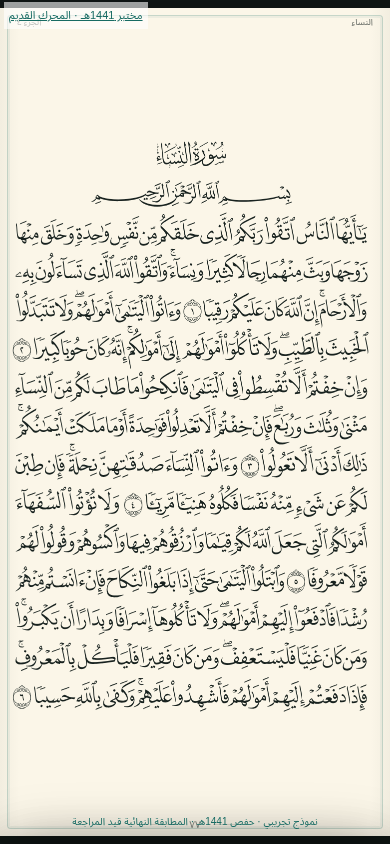|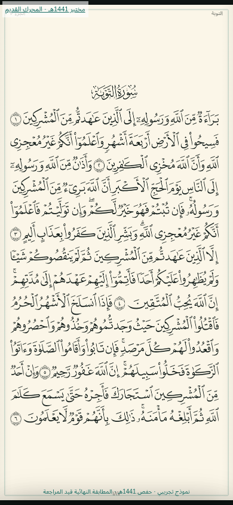|

|208 — يونس|262 — اختلاف تقسيم15:7|282 — افتتاح سورة|
|---|---|---|
|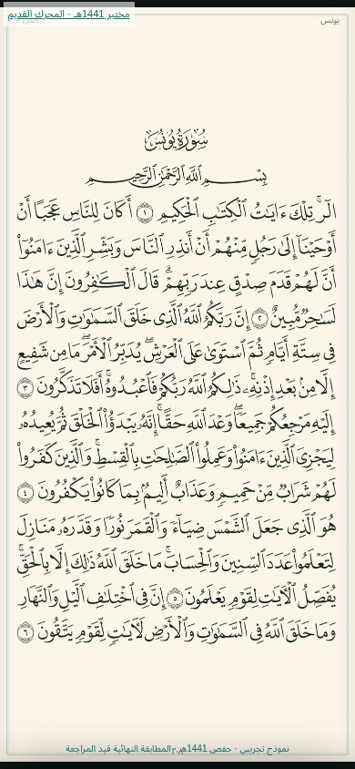|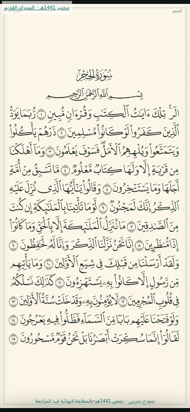|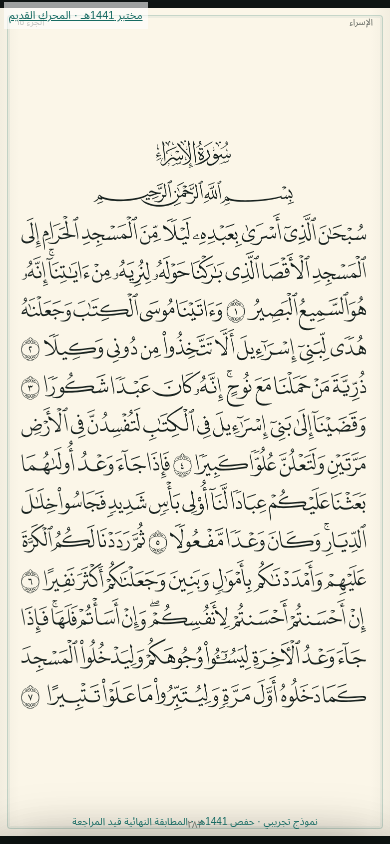|

|428|451|602|604|
|---|---|---|---|
|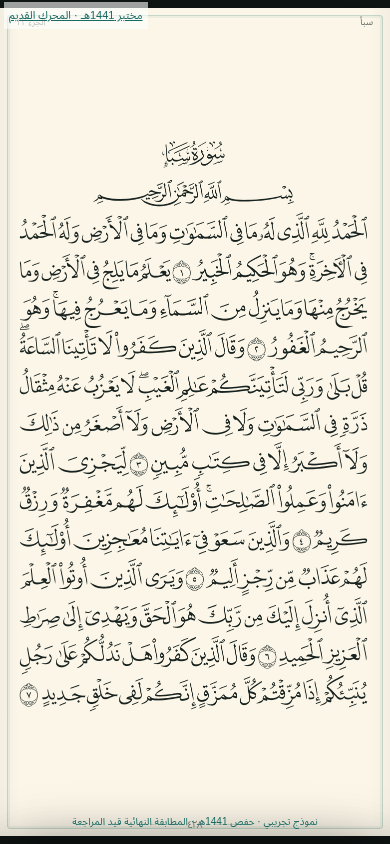|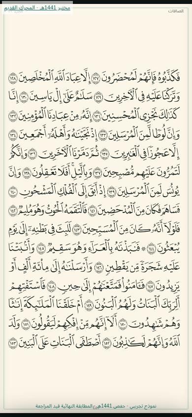|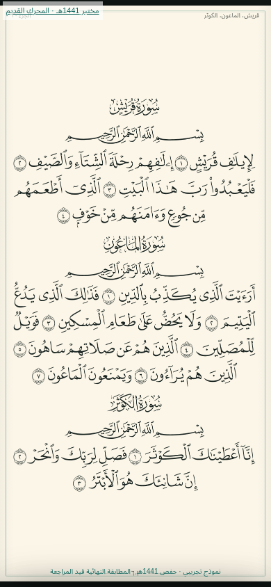|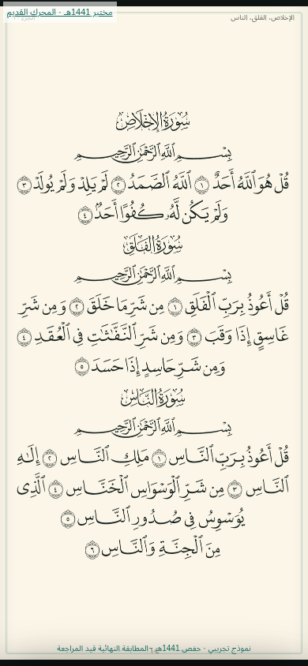|

[التدقيق](../../docs/MUSHAF_ENGINE_AUDIT.md) ·
[المقارنة](../../docs/MUSHAF_ENGINE_COMPARISON.md) ·
[مصفوفة المزايا](../../docs/MUSHAF_FEATURE_PARITY.md) ·
[نتائج التحقق](../../docs/MUSHAF_VALIDATION.md) ·
[التراخيص](../../docs/MUSHAF_LICENSING.md) ·
[التشغيل والكود والاختبارات](../../tests/madinah-engine/README.md) ·
[الأدلة الآلية](../../docs/mushaf-evidence)

[APK المختبر المستقل — Actions Artifact](https://github.com/sofian741/quran-app/actions/runs/41708825945/artifacts/13266747377)
— بُني بنجاح؛ الحزمة نحو 65.14 MiB وتشمل النتائج؛ متاحة حتى 17 نوفمبر 2026.
لم تُختبر على جهاز، ولا تستبدل التطبيق الحالي.
