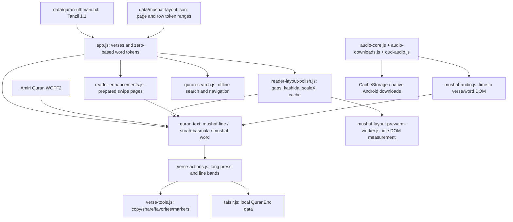

# Mushaf engine audit — phase zero

> تحديث مرحلة الدمج: أذن المستخدم باعتماد QVP كأساس داخل التطبيق الأصلي مع بقاء المشكلات المعلنة.
> راجع [تنفيذ الدمج الحالي واختباراته والرجوع](QVP_PRODUCTION_INTEGRATION.md).
> نتائج/بوابات المختبر أدناه سجل تاريخي، وليست وصفًا بأن التطبيق الحالي ما زال يستخدم العرض القديم.

Audit baseline: `sofian741/quran-app`, latest fetched `main` commit
`8cf64b0865a37f8bf7a4ec019450d1a2e0cd0350` (2026-11-03).
Work branch: `feature/madinah-mushaf-engine`. This audit was written **before
prototype implementation**. No production engine file was edited during phase zero.

## Scope and method

Enumerated the entire Git tree (including hidden workflows, Android sources,
binary fonts, compressed timing datasets, tests, historical screenshots and release
documents). No AGENTS.md applies to this application checkout. Read the reader
implementation and its directly and indirectly loaded collaborators; inspected data
schemas, checksums, packaging and test assertions rather than trusting older README
claims. Historical notes describe several superseded builds and are not runtime authority.
The inventory accompanying this report records every baseline tracked file and blob ID.
Binary assets were inspected through metadata, checksums, data decoding and existing
validators, not interpreted as source code.

## Architecture and data flow

`quran.html` loads scripts in this order: service-worker registration, Android
navigation/build info/updater, app, reader enhancements, layout polish, keyboard
viewport lock, verse actions, tafsir, search, verse tools, audio core, downloads,
native background downloads, optional bundled Mishary hooks, QUD registry/adapter,
offline reciter catalog, connectivity, Mushaf audio UI and tour.
`reader-layout-polish.js` dynamically inserts the prewarmer. The script called
“worker” is a main-thread DOM script, not a Web Worker.

The stable public facade is `window.mushafReader`: getCurrentPage, getVerse,
getSearchVerses, getSurahName, findVersePage, goToPage, goToVerse,
getPageLayout, fitElement, clearFitCache, turnPageInstant and ornament factories.
Events: `mushaf:data-ready`, `mushaf:page-changed`, `mushaf:page-ready`,
`mushaf:verse-selected`, `mushaf:reciter-changed`.
Consumers also depend on DOM classes and `data-verse="s:a"`, `data-word="0-based"`.
Replacing just the facade does not preserve compatibility.

## Text, font, layout, decorations

* The immutable text is Tanzil Uthmani 1.1, local `data/quran-uthmani.txt`, SHA-256
  `aa0bf9278a177a12e6d9bef621ce37a1d24fa35168b5ae9c13ebcbe01e3686cf`.
  It has 6,236 verse records. Prefix ۞ is attached to the next token and eight
  standalone stop/sajdah marks to the previous token, with a narrow no-break space
  for display. This yields **77,881 tokens**, including four introductory basmala
  tokens inside verse 1 for 112 surahs. These are excluded from spoken words.
* Layout is `zonetecde/mushaf-layout@72116ce4d405d67823804f0eed795c1e6409b4af`.
  The local file stores only `h` heading, `b` basmala and `l` text rows with
  half-open global token intervals. All 604 pages are validated for contiguous
  coverage. Layout SHA-256 is
  `72d5d5743160f4be6a5c983723ccc6f5549fb28e11a11fd68896ba8b088585cd`.
* `scripts/build-mushaf-layout.cjs` aligns normalized upstream row text by edit
  distance. It derives headings from surah transitions (fixing the historical
  spurious page-207 Tawbah header/Yunus displacement). It is a heuristic importer,
  not proof of identical printed words or marks. Do not regenerate it for this POC.
* Amiri Quran Regular is a local 45,680-byte WOFF2, SIL OFL 1.1. It shapes Unicode;
  it is not the page-specific outline artwork of an identified Madinah edition.
* `app.js` changes page 1's row ends at runtime to `[4,9,14,19,23,27,29]`, distinct
  from the stored layout. Opening pages use a special font fitting path.
* Standard pages use width/height font fitting, bounded gaps `.12–.30em`, up to
  four tatweels per word / 32 per row, then horizontal compression down to `.64`.
  `originalWordText` preserves text for reset but rendered DOM contains tatweels.
  The new engine must never copy Quran text from stretched DOM.
* Verse markers and surah bands are original local CSS/SVG designs; chapter names
  are shaped text. They are not a facsimile of printed decorations.
* `offline-reciter-catalog.js` ليس كتالوجًا فقط: يحقن أيضًا text-stroke بقيمة
  .28px وبديل text-shadow على كلمات المصحف؛ هذا أثر غير مباشر في سمك الحبر.
  عارض Canvas لا يعيد استخدام هذا الرسم النصي، والنسخة الأصلية محفوظة.
* Fit caches: app memory cache (48 entries), layout memory and IndexedDB
  `quranMushafLayoutCache` / `layouts`, version `standard-larger-type-v8-20261019`.
  Cached records contain rendered word strings and geometry; only version, range
  and count checks protect them. New engine data needs a separate namespace.

## Current features and contracts

| Feature | Current implementation and dependencies |
|---|---|
| 604 pages, RTL turns | app page state; touch capture override in reader-enhancements; prepared adjacent DOMs adopted by turnPageInstant; arrows in app |
| Index | 114 surahs and 30 juz; surah filter and expandable per-ayah search; app's canonical verses and token-to-page lookup |
| Pinch and pan | native visual viewport; `user-scalable=yes`, CSS `pan-y pinch-zoom`; visualViewport.scale >= 1.01 suspends page turns and enables both pan axes |
| Long press | verse-actions: 500 ms, cancel after 12 px; nearest word or verse-end group; cancels swipe; line-local continuous selection bands |
| Verse/word audio highlighting | mushaf-audio: AudioEngine state/time plus rAF; DOM rows and word bounding boxes; spoken list excludes basmala except Fatiha; grouped endWord ranges supported |
| Reciters | Mishary 7; 18 eligible local QUD reciters (19 datasets, 9017 excluded for unreliable alignment); Foundation 9020/9021/9022; discovery and cached catalog; separate MP3Quran library |
| Recording/timing pairing | audio-downloads patches AudioEngine to continuous chapter recordings, absolute ms; QUD patches same prototype; exact audio URL accompanies timing. Source recordings must not be substituted |
| Timing validation | current syncHighlight accepts an in-range maximum ordinal, not exact lexical correspondence. Uses currently rendered word count, which can be partial for cross-page verses. README's strict-count claim is stale |
| Repeat, speed, seek, follow | engine/provider wrappers and mushaf-audio; chapter/verse/range, real timestamps, Media Session; follow uses findVersePage |
| Download/offline | Cache Storage audio and metadata; blob playback; native DownloadManager and persisted pending jobs; catalog/timing resources; streaming is not automatically offline |
| Android bundled recitation | optional historical hooks exist in source. Current prepare script removes both hooks and the whole preinstalled Mishary pack; it decodes all 19 QUD gzip files into JSON in generated www |
| Favorites and reading markers | verse-tools: `quranVerseFavoritesV1`, `quranReadingMarkerV1`, `quranPageMarkerV1`; stable verse keys plus page |
| Last reading position | app: `quranReaderState` stores displayPage/surah/ayah; home.js reads it; deep links handled by reader-layout-polish |
| Search and copy | search folds Tanzil for matching only; copy retrieves original getVerse text; never copy new glyph codes or SVG paths |
| Tafsir | tafsir.js reads local 6,236 QuranEnc records, validates key/count, separate swiping sheet, canonical chapter lengths from audio-core; Android prepare copies scripts dataset to data |
| Image sharing | verse-tools renders a separate Unicode/Amiri canvas card, not a page crop |
| Themes | quranReaderSettings presets; UI chiefly paper/text colors. Fixed font/line-height preferences are internal, not user sliders; home theme is separate |
| Keyboard | mushaf-keyboard-viewport pins reader/stage boxes during software keyboard, releases after viewport recovery |
| Tutorials | tour.js uses actual index/settings/verse/audio panels, reader facade and selectors; must exercise on new renderer |
| Background listening while reading | ayat-reading-continuity keeps library/recitations audio in parent document and opens quran.html in same-origin iframe; iframe and parent Back ownership coordinated |
| Native navigation/screen wake | android-navigation plus MainActivity; closes known dialogs, handles Back, wake lock; native download plugin is registered before super.onCreate |
| Update channel | app-update reads generated build metadata; production workflow publishes latest qa tag/Ayat.apk. Must never dispatch or change that workflow for the experiment |

## File boundaries reviewed

| Area | Files / reason |
|---|---|
| Reader | quran.html, app.js, style.css, reader-enhancements.{js,css}, reader-layout-polish.js, mushaf-layout-prewarm-worker.js, mushaf-keyboard-viewport.js |
| Text and type | data/quran-uthmani.txt, data/mushaf-layout.json, data/mushaf-layout-LICENSE.txt, assets/fonts/*, build-mushaf-layout.cjs |
| Interaction | verse-actions.js, verse-tools.js, quran-search.js, tafsir.js, scripts/tafsir_muyassar.json, tour*.{js,css} |
| Audio | audio-core.js, audio-downloads.js, mushaf-audio.js, qud-audio.js, data/qud/*, audio-library.js, audio-bulk-download.js, offline-mishary*.js, offline-reciter-catalog.js, native-background-audio.js, audio-player.css |
| App entry surfaces | index.html/home.js/home-settings.js/global-theme.js, recitations.{html,js,css}, library.{html,js,css}, ayat-reading-continuity.*, ayat-connectivity.js; home deep links and iframe/audio ownership are relevant |
| Native/build/update | capacitor.config.json, package.json, android-native/*, android-navigation.js, android-build-info.js, app-update.js, scripts/prepare-android-web.mjs, register-background-downloads.py, write-android-build-info.py, android-assets and all .github/workflows |
| Data preparation | build-synced-mishary.py, fetch-mishary-audio.py, sync_qud_audio.py, build_verified_qud.py, download_tafsir_muyassar.py; do not re-fetch/rewrite recording timings |
| Offline | sw.js, service-worker-register.js, source and generated packaging paths |
| Existing evidence | all tests/* inspected by purpose and assertions, historical artifacts, AI_CONTEXT.md, README, SOURCES, ANDROID_BUILD, MUSHAF_PROGRESS, docs/MISHARY_AUDIO_READY, RELEASE_AUDIT/* and licenses.html |
| Other features | adhkar*, onboarding*, welcome*, home decorative styles and legal pages were inventoried and their imports/storage checked; no rendering dependency requiring edits was found |

## Baseline results before implementation

Executed successfully: `tests/content.cjs`, `tests/data-integrity.cjs`,
`tests/audio-core.cjs`; 13 node tests across offline-audio, bundled-mishary,
offline-mishary-sync and qa53-stability. Initial restricted execution produced a
child-process EPERM; rerunning with supported execution permissions passed. This
was an environment limitation, not an application fix. Browser/device baseline
results are recorded separately in MUSHAF_VALIDATION.md when executed.

## Weaknesses and replacement risks

1. No precise printed edition is pinned by the production renderer. General
   “Madinah” page numbering is not evidence of glyph/row identity.
2. Source text, row importer, runtime Fatiha breaks and font fitting are independent.
   Correct verse coverage can coexist with a visually wrong page.
3. Repeated tokenizers across app/swipe/prewarmer can diverge. New renderer should
   have one separately tested source adapter, without changing production paths.
4. Word ordinals and basmala handling differ by source/edition; equal counts alone
   do not prove correct audio alignment, especially fused/split compounds.
5. DOM geometry is an implicit interface used by search, long press and audio.
   Canvas or SVG needs an explicit bridge, including markers and multi-line ayahs.
6. Cached or late pages can race navigation and audio. Failed page loads must keep
   the previous page/state and must not show the wrong verse under a new page number.
7. SVG path volume can inflate APK/DOM memory; Canvas can soften marks at low DPR.
   Bound resident pages and measure both geometry and raster output.
8. Existing offline behavior depends on generated assets; the source Service Worker
   lists data/tafsir_muyassar.json, while source stores tafsir under scripts/.
   Do not silently claim cold source-site offline readiness.
9. **Preserve `MushafTextScale.load(): settings.setTextZoom(100)` and registration
   before `super.onCreate(state)`.** Keep native pinch zoom enabled separately.
10. Rights for artwork, transformation code, indexes, fonts and audio are separate.
    A repository's MIT/CC notice alone is not ownership of KFGQPC artwork.

## Acceptance tests required before replacing production

604-page word/verse/order/marker and line coverage; independent text comparison;
explicit compound/basmala maps with no guessed timings; fixed, checksum-pinned
reference rasters; page 1/4, openings, Tawbah, dense waqf and long multi-line ayahs;
word tap and long press, both highlight levels, index/search/copy/tafsir/share,
all bookmark types and restart; sequential/reverse/boundary page turns; zoom/pan;
phone/tablet geometry and dark/custom colors; fully local loading with network
blocked; recorded speed/heap/page-cache limits; Android Text Zoom registration;
real Android font scales and Infinix test; native audio, background and download
regressions; separate APK identity and no updater/release publishing. Any unresolved
parity, text, edition or rights gate blocks production integration.
