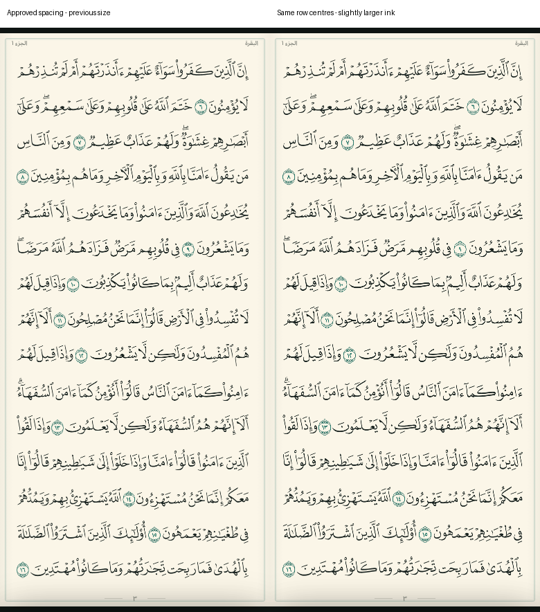
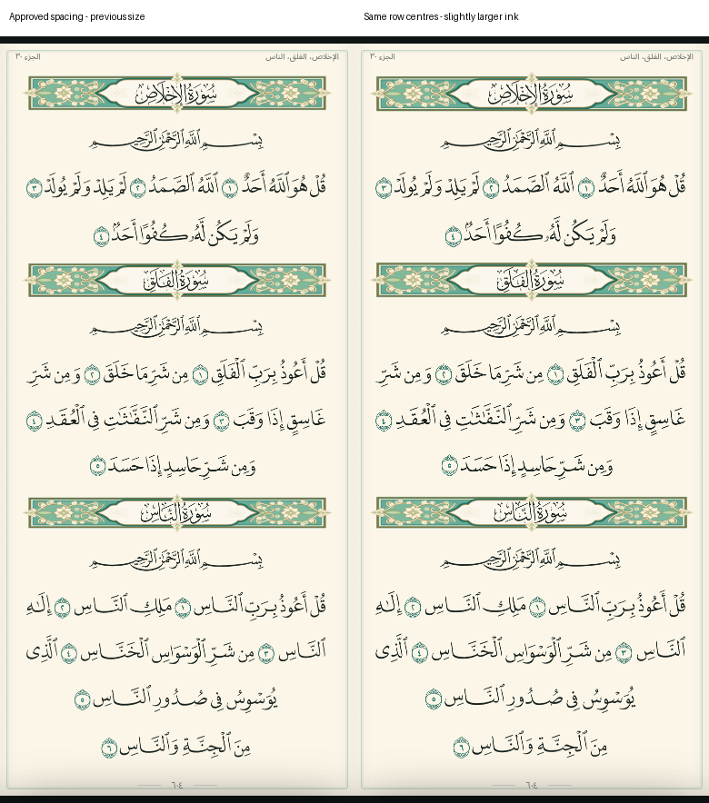

# تكبير خفيف مع الاحتفاظ بتوزيع السطور المعتمد

تعديل تالٍ لنتيجة `0edc7db` التي وافق المستخدم على توزيعها. نفس الفرع
`feature/qvp-uniform-page-spacing`؛ لا تعديل لـmain ولا APK أو نشر تلقائي.

الصفحات 3–604 تحتفظ بارتفاع 760 وبمراكز السطور 30/80/…/730 نفسها. كل مسارات الحروف
وعلاماتها تُكبر **1.035** أفقيًا ورأسيًا حول مركز السطر، مع توسيع مساحة الرسم من 345 إلى 360
وحدة وتوسيط المحتوى فيها. لا تغيير ترتيب الكلمات أو تقسيم الأسطر، ولا تكبير كامل للصفحة يقتطع
أطرافها. نسبة التكبير الظاهرة تعتمد أيضًا على ملاءمة القالب للمساحة المتاحة.
الترويسة تشغل العرض الإضافي نفسه، أي يزيد عرض إطارها بنحو 4.45% في إحداثيات القالب.
الصفحتان 1 و2 تحتفظان بالتكبير الموحد ×1.5 الذي سبق اعتماده.

صناديق اللمس والتظليل تستخدم التحويل نفسه، وأزيل الاعتماد على العرض 345 من دالة الرسم
ومن فحص مواضع DOM؛ أصبح العرض الفعلي للصفحة هو المرجع. حد ذاكرة Canvas وكاش 3 صفحات
وText Zoom 100% لم يتغيروا. المصدر القرآني والتوقيتات وملفات QVP الأصلية كما هي.

الفحص المحلي: اختبارات البيانات والتحويل الهندسي لجميع الصفحات، وعدم قص الحبر أفقيًا أو
رأسيًا، والترويسات والضغط المطول والتظليل بما فيه 15:7 والبسملة، وجولة المصحف.
التحويل يبقى موحدًا في الاتجاهين للحروف مع نفس شبكة السطور في جميع الصفحات العادية؛
الفراغ بين حدود الحبر يقل قليلًا نتيجة زيادة حجمه، مع بقاء صناديق الحبر متباعدة.

صور مقارنة فعلية بمساحة 390×844، اليسار النسخة المعتمدة واليمين الحجم الجديد:

التشغيل المحلي كما هو: `npm run qvp:prepare` ثم `npm run dev`.
الاختبار: `npm run test:qvp` و`npm run test:tour:qvp`.
