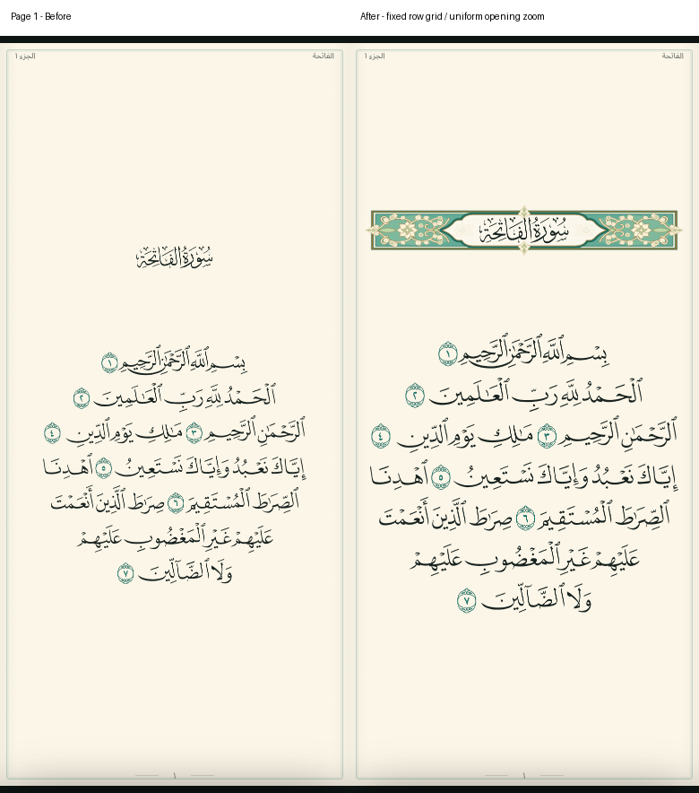
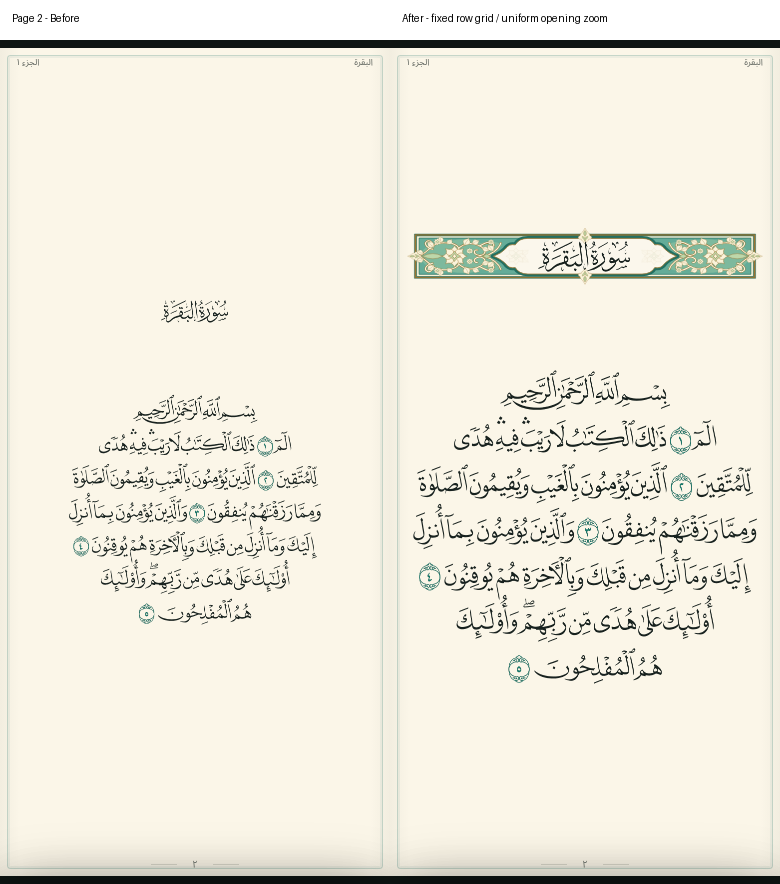
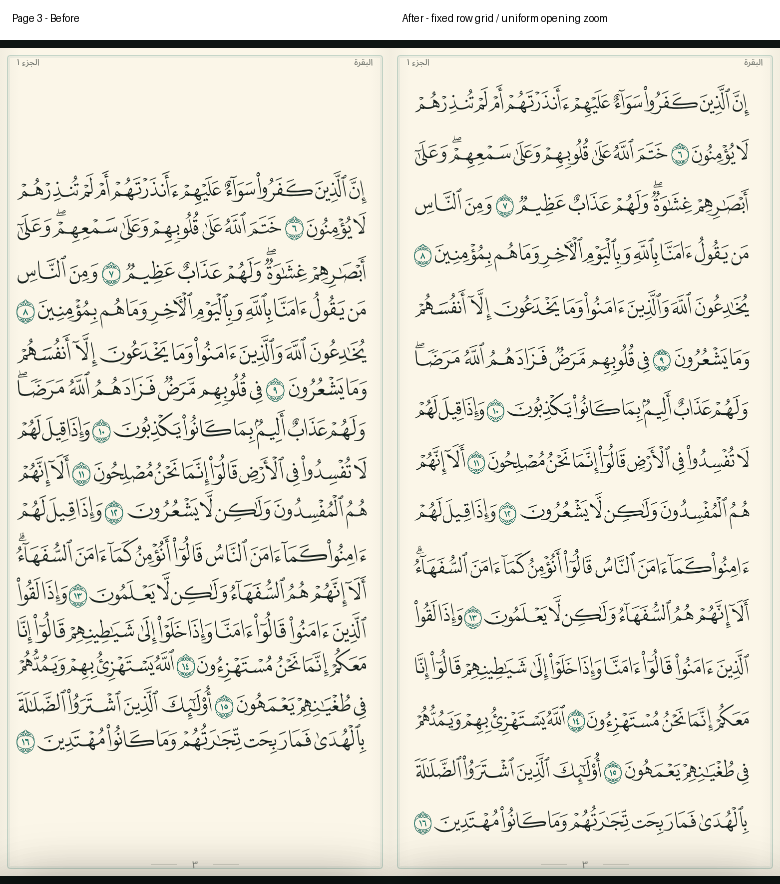
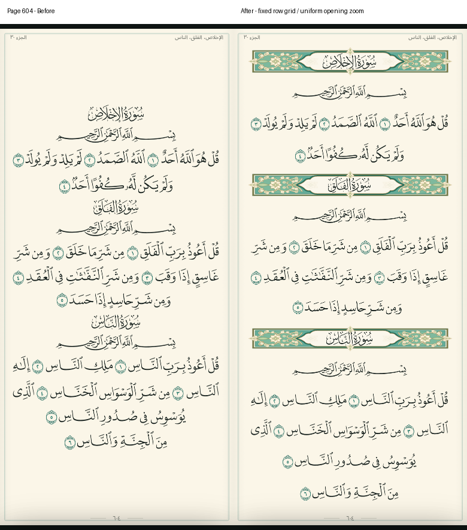

# مسافات المصحف الموحدة وتكبير صفحتي الافتتاح

2026-11-04. الفرع `feature/qvp-uniform-page-spacing` من أحدث main عند
`b243297f4c5dc94497b425e194033b59ea481901`. لم يُعدل main ولم تُنشأ PR.

## التعديل الذي استُبدل

التعديل `b3dc593` كان يجمع ارتفاع الحبر في كل صفحة ثم يقسم الفراغ المتبقي بالتساوي.
بهذا تتغير مواضع السطور حسب الحروف والتشكيل في الصفحة. وكان يحتفظ بإطار 345×550
القصير حتى على الهواتف الطويلة، ويُلحق علامات الآيات بأقرب سطر هندسيًا.
تم استبدال خوارزمية `line-layout.js` نفسها، دون رجوع جماعي للـcommits أو خلط خوارزميتين.
بقية تغييرات main والصفحة الرئيسية والمكتبة والأذكار والصوت والتخزين محفوظة.

## الحساب الحالي

قالب ثابت `345×760` للصفحات 3–604، مكون من **15 خانة**:

```text
15 × ارتفاع خانة 40 + 16 × فراغ 10 = 760
مركز الخانة i = 30 + 50 × i   (i = 0..14)
```

تُحرك كل مسارات السطر معًا إلى مركز الخانة، وفق مركز الحروف الأساسية دون التشكيل،
بنفس نهج مرجع Quran Engine المثبت في `sources.json`، `qvp-core/src/lib.rs`.
تظل الحروف والكلمات وعلاماتها كما هي، بلا تمديد رأسي للحروف أو إعادة توزيع كلمات.
يُصغر/يكبر القالب كاملًا بنسبة موحدة ليناسب المساحة، فلا توجد قواعد خاصة بهاتف بعينه.

الفراغ 10 بين **خانات السطور** وفوقها وتحتها ثابت. الفراغ بين أبعد نقطتين من الحبر قد يختلف
بسبب المدود والتشكيل؛ لا نزعم تساوي صناديق الحبر المختلفة. شبكة المواضع ثابتة في جميع
الصفحات العادية، فلا تغيّرها الحروف الطويلة أو علامات الوقف في صفحة بعينها.

الترويسة والبسملة تشغلان خانتيهما الأصليتين: 15 سطر قرآن دون ترويسة، و13 مع ترويسة وبسملة،
و11 مع اثنتين، و9 مع ثلاث. التوبة لها ترويسة دون بسملة، فتبقى 14 خانة قرآن كما يقرر المصدر.
إطار اسم السورة يُحسب من حجم العنوان مع حشوة، ويُعرض بعرض الصفحة فوق خلفيته الأصلية؛
لا يتداخل مع السطر السابق أو البسملة. أُصلحت ألوان الإطار غير الموروثة التي كانت تجعله غير مرئي،
مع الإبقاء على رسم الزخرفة الموجود وثيمه الليلي.

الصفحتان 1 و2 لا تدخلان في شبكة الأسطر: **تحويل موحد ×1.5** لكل مسارات QVP وإحداثيات
الكلمات والعلامات، مع الحفاظ على التكوين والفواصل النسبية داخل الصفحة. لا زيادة أسطر أو تغيير توزيع.

## سلامة التفاعل والحبر

- الرسم والكلمات وصناديق اللمس والتظليل تتحرك في نفس الإحداثيات. التحويل من لمس الشاشة
  يستخدم ارتفاع القالب الفعلي 760 أو 550، ومعاينة التقليب تستخدم نفس القالب.
- علامة نهاية الآية تتحرك مع آخر كلمة في الآية بمعرفها، وليس باختيار أقرب سطر.
- خط السجدة يتبع الكلمات التي تحته، حتى عندما تكون علامة السجدة النهائية بعد عدة سطور.
- توجد أربعة مسارات في الصفحة 17 خارج viewBox المصدر. تبقى محفوظة في البيانات، ولا يُظهرها
  القالب الأطول؛ فهي رقم صفحة وترويسة كان المصدر نفسه يقصهما.
- SHA-256 للملفات القرآنية المصدر والنص وترتيب الكلمات والتوقيتات لم يتغير.
- الحساب مرة واحدة عند فك الصفحة، مع الاحتفاظ بذاكرة 3 صفحات؛ لا إعادة تخطيط عند كل إطار صوت.
- appId وتوقيع QA وText Zoom 100% وإعدادات التشغيل والتنزيل لم تتغير.

## الصور الفعلية

اليسار هو main عند `b243297`، واليمين هذا الفرع. كلاهما Chromium بمساحة 390×844 وثيم paper.
هذه صور من تشغيل التطبيق، وليست تصميمًا مرسومًا أو صورًا مولدة.









## التحقق المنفذ

- 8 اختبارات آلية: سلامة المصدر، وSHA-256، و15:7، والإعدادات، والترويسات، والتحويل الهندسي.
  اختبار التحويل يمر على جميع الصفحات 3–604، ويقارن كل نقطة في مسارات الرسم بالمصدر؛
  الإحداثي الأفقي ثابت والعمودي إزاحة واحدة لكل سطر، مع الحفاظ على كل مسار وعلامة.
- جميع السطور في الصفحات الـ602 على شبكة 30/80/130/…/730 نفسها. لا قص للحبر ولا تداخل
  لصناديق الحبر المتجاورة؛ أصغر فراغ مقاس 1.8999996 وحدة. كل إطارات الترويسات لا تتداخل مع الجيران.
- صفحتا الافتتاح: كل إحداثي خضع لنفس معامل ×1.5 والتحويل الأفقي/العمودي؛ لا قص للكلمات أو العلامات.
- 14 سيناريو متصفح: الصفحات الـ604 كلها، ومقارنة صناديق اللمس، وشبكة صفحات عادية مختلفة،
  وضغط مطول فعلي على آخر سطر من 604، وإطارات السور وثيمها الليلي، و70 حالة صفحة/حجم شاشة،
  والبحث والفهرس والمفضلة والنسخ والتفسير والمشاركة والفواصل واستعادة الموضع والتظليل كلمة بكلمة
  بما فيه 15:7 والبسملة، ومحاكاة pinch، والمعاينات وفشل التحميل وتنافس التنقل.
- الصفحات الـ604 تعاد قراءتها بعد قطع شبكة المتصفح. جولة المصحف نجحت، وكذلك فحص LAN
  لجميع صفحات التطبيق، وفحص CSP والوحدات الأساسية لمزامنة الصوت.
- قيس في Chromium المحلي: وسيط تقليب 44.1ms وP95 نحو 78.3ms، وذاكرة JS نحو 41.7MB
  في الجولة الكاملة، وكاش 3 صفحات. هذه قياسات محلية وليست Android حقيقيًا أو قياسًا شاملًا للذاكرة.
- `npm run android:prepare` يجهز الصفحات الأصلية الـ604 مع كود العرض المعدل داخل `www/`.
  بناء APK التلقائي يظل متوقفًا كما في main؛ لا تغيير لقناة التحديث ولا نشر عام.

إعادة التشغيل:

```bash
npm ci
npm run qvp:prepare
npm run dev
# http://127.0.0.1:4173/quran.html
npm run test:qvp
npm run test:tour:qvp
node tests/qvp-layout-capture.cjs
```

اختبارات المتصفح تحتاج Playwright وChromium، كما هو موضح في README. لصور قبل/بعد شغّل
worktree منفصلًا من `b243297` ببيانات QVP المعدة، وحدد `QVP_BEFORE_URL` مع `QURAN_BASE_URL`.
النتائج الأصلية للمتصفح مرفقة في `results/qvp-spacing/browser-local.json`؛ صور CI تنتج عبر
`Verify QVP reader layout in browser` الذي يختبر الفرع دون إنشاء APK.

المتبقي: فحص النظر واللمس وpinch على هاتف المستخدم الفعلي. هذا تعديل لقالب العرض بطلب المستخدم؛
يحافظ على رسم الكلمات وتقسيم السطور، ولا يمثل ادعاء تطابق الإحداثيات الرأسية المعدلة مع الطبعة الورقية.
